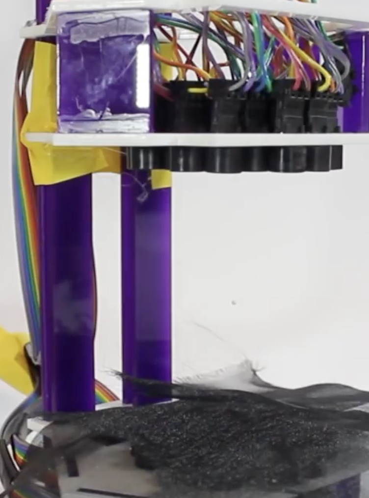

# NeuroLev: Moving Levitated Droplets with Thought

Look at a flickering light, and a droplet of water floating in midair moves that way.

NeuroLev connects a consumer EEG headset to an ultrasonic phased array. The headset reads your visual cortex, a decoder figures out which light you're looking at, and 128 ultrasonic transducers reshape sound waves to push a levitated droplet in that direction. Steer two droplets together and they merge in midair.

> **Status: work in progress.** The decoder, phase solver, control loop and stimulus firmware are written and tested on simulated data. Hardware integration and real-user testing are underway; results below will be filled in as they're measured.



## How it works

```
 5 LEDs flickering          EEG headset on the        FBCCA decoder           Phase solver          Two 8x8 ultrasonic
 at 7, 9, 11, 13, 15 Hz ──► back of the head    ──►  "which frequency is ──► per-transducer   ──►  arrays (40 kHz) move
 (one per command)          (O1, Oz, O2)              strongest?"             emission phases       the droplet
```

**1. Your brain echoes the flicker.** When you stare at a light flickering at 13 Hz, neurons in your visual cortex start firing at 13 Hz (plus 26 Hz and 39 Hz harmonics). This is a *steady-state visually evoked potential* (SSVEP), and it's strong enough to pick up through the skull with a few electrodes over the back of the head.

**2. The decoder finds the rhythm.** Every half second, the last 2.5 s of EEG is compared against clean sine-wave templates at each LED's frequency using *filter-bank canonical correlation analysis* (FBCCA, Chen et al. 2015). The best match is the light you're watching. FBCCA needs no per-user training, so a new person can use it right away.

**3. Safeguards stop accidental commands.** Windows with blinks, head movement, or jaw-clench muscle noise are thrown out. A command only fires when the best match clearly beats the runner-up *and* two consecutive windows agree.

**4. Sound waves move the droplet.** Each transducer's phase is set so its wave arrives at the target point in step with all the others. The top array is offset by half a cycle, which creates a standing wave with a low-pressure node exactly at the target. The droplet sits in that node; move the target 2 mm, recompute the phases, and the droplet follows.

## Commands

| LED frequency | Command | Effect |
|---|---|---|
| 7 Hz | LEFT | Move droplet A left |
| 9 Hz | RIGHT | Move droplet A right |
| 11 Hz | FORWARD | Move droplet A forward |
| 13 Hz | BACK | Move droplet A back |
| 15 Hz | MERGE | Glide droplet A toward droplet B until they merge |

10 Hz is skipped on purpose: it's where the brain's natural alpha rhythm lives, and it gets louder when you relax.

## Hardware

| Part | Notes |
|---|---|
| OpenBCI Ganglion (4-channel) | Any [BrainFlow](https://brainflow.org)-supported board works |
| Electrodes over O1, Oz, O2 + reference/ground | SSVEP is strongest over the visual cortex; forehead headsets won't work |
| 2 x 8x8 ultrasonic arrays (40 kHz, 10 mm transducers) | Based on the open-source [Ultraino](https://github.com/asiermarzo/Ultraino) design |
| Array driver (Arduino Mega per 64 channels, per Ultraino) | `SerialTransport` must be matched to your driver firmware |
| Arduino (any) + 5 LEDs + diffusers | Runs `firmware/led_stimulus` |

## Quick start

```bash
pip install -r requirements.txt

# Run the tests (no hardware needed)
python -m pytest

# Full pipeline with a simulated brain and the levitator in dry-run mode
python scripts/run_demo.py --source simulated --dry-run

# Real headset, levitator not connected yet
python scripts/run_demo.py --source ganglion --serial-port /dev/ttyACM0 --dry-run

# Measure real accuracy on a person (saves raw EEG + results to data/<subject>/)
python scripts/run_eval_session.py --source ganglion --serial-port COM3 --subject alex
```

Flash `firmware/led_stimulus/led_stimulus.ino` to an Arduino for the flickering targets. Its frequencies must match `neurolev/config.py`.

## Repository layout

```
neurolev/
  config.py      all tunable settings in one place
  eeg.py         BrainFlow headset stream + EEG simulator
  ssvep.py       FBCCA decoder and command gate
  artifacts.py   blink / movement / muscle-noise rejection
  levitator.py   phase solver, pressure-field check, serial driver
  control.py     droplet positions, bounds, merging
  metrics.py     information transfer rate (Wolpaw)
scripts/
  run_demo.py             live headset -> droplets
  run_eval_session.py     cued accuracy test on a real person
  benchmark_simulated.py  decoder sanity check on simulated EEG
firmware/led_stimulus/    Arduino code for the flickering LEDs
tests/                    pytest suite
```

## Results

Measured with `scripts/run_eval_session.py`. Information transfer rate counts 2.5 s of decoding plus 1 s for the user to shift their gaze.

| Metric | Value |
|---|---|
| Users tested | _TBD_ |
| Mean accuracy (5 targets) | _TBD_ |
| Information transfer rate | _TBD_ bits/min |
| Droplet positioning accuracy | _TBD_ |
| Successful midair merges | _TBD_ |

## Safety

- **Photosensitive epilepsy:** flickering light in the 3-30 Hz range can trigger seizures. Tell everyone before they try it and don't run it on anyone with a seizure history.
- **Ultrasound:** 40 kHz at these power levels is inaudible and widely used in hobby levitators, but don't put your ears right against the arrays for long periods.

## Credits

- Ultraino: Marzo, Corkett & Drinkwater, *IEEE Trans. Ultrasonics, Ferroelectrics, and Frequency Control* (2018)
- FBCCA: Chen, Wang, Gao, Jung & Gao, *Journal of Neural Engineering* 12(4) (2015)
- EEG streaming via [BrainFlow](https://brainflow.org)

## License

MIT
